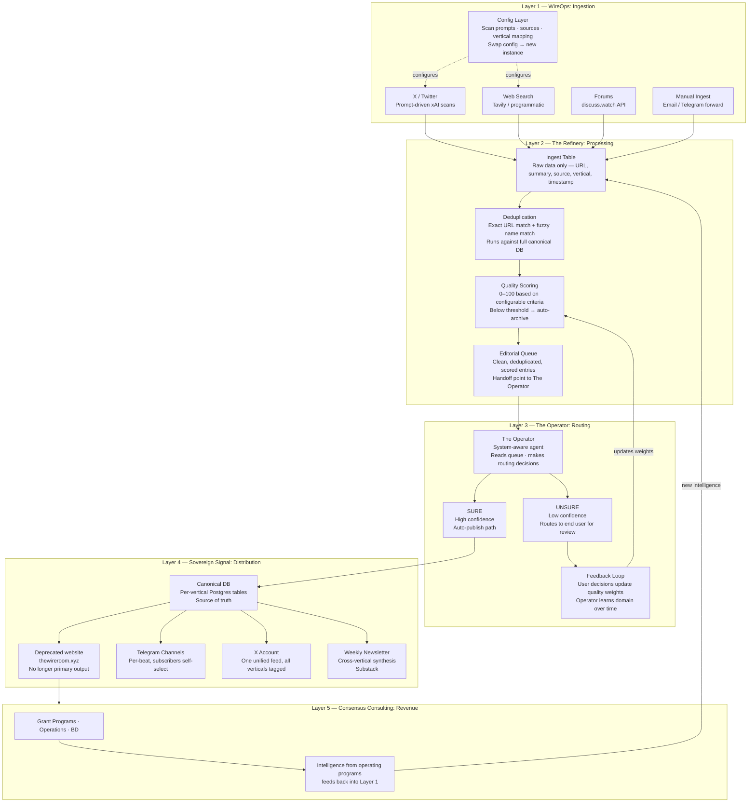

# Wire Architecture

> **Historical note**: Parts of this document are outdated and should not be used as an operational runbook. The Wire Room frontend (thewireroom.xyz) is deprecated. The system now distributes to Telegram channels, X, newsletter, and email under the Sovereign Signal brand. `CLAUDE.md` and `STRINGER.md` are the current references.

> The intelligence-to-distribution pipeline. Config-driven, operator-agnostic, deployable for any domain.

## Design Principles

**The Operator learns the domain. It ships knowing the system.**

When The Operator is deployed into a new instance, it arrives with complete knowledge of the pipeline — the schema, the flow, the routing rules. It does not arrive pre-loaded with domain expertise. That comes from the end user over time.

Every UNSURE routing decision is a training rep. The Operator watches what the user approves and rejects. Quality scoring weights are tunable per deployment. Over time, The Operator develops domain judgment organically — learning "what's a good crypto grant" the same way it would learn "what's a good consulting lead" in a different deployment.

This is intentional. The same Operator can be dropped into any vertical.

**Config drives behavior. Swap config, get a new instance.**

Scan prompts, source lists, scoring weights, distribution destinations, Telegram channel IDs — all stored in the database, not hardcoded. The engine is identical across deployments. The configuration is what makes one instance a grants wire and another a lead intelligence system.

Brand-level configuration (`src/config/brand.ts`) lets each deployment define its audience, content type, and action verb via environment variables. AI prompts (Grok, Claude, Perplexity), quality scoring keywords, and email templates all read from `getBrand()` instead of hardcoding "grant seekers" or "grant funding opportunities." Wire lists are loaded from the DB `feeds` table at runtime — no hardcoded `["crypto","ai","oss"]` arrays.

**The system learns in the open.**

User decisions feed back into quality scoring. Nothing is a black box. The Operator explains its reasoning when routing UNSURE items. The end user understands why things are being approved or rejected.

---

## System Flow



---

## Multi-Channel Ingestion Architecture

Ingestion follows an **adapter + core** pattern:

```
Channel Adapter                  Intake Core
(protocol-specific)              (channel-agnostic)
┌───────────────────┐           ┌───────────────────────────┐
│ telegram-adapter   │──────────▶│ intake-core.ts            │
│ (webhook, inline   │           │ - URL extraction          │
│  keyboard, auth)   │           │ - Wire detection (keyword │
├───────────────────┤           │   scoring from DB/env)    │
│ future: slack      │──────────▶│ - DB insert (raw entry)   │
├───────────────────┤           │ - Pending wire selection   │
│ future: discord    │──────────▶│   (in-memory, 1hr expiry) │
├───────────────────┤           └───────────────────────────┘
│ future: email      │──────────▶
└───────────────────┘
```

**Key files:**
- `src/services/intake-core.ts` — channel-agnostic logic: `processIntakeMessage()` accepts an `IntakeMessage`, detects wire, inserts entry
- `src/services/telegram-adapter.ts` — Telegram webhook handler, inline keyboard for wire selection, `setWebhook` on startup

**Wire detection:** Per-wire keyword lists are loaded from `INTAKE_WIRE_KEYWORDS_{WIRE}` env vars with built-in defaults as fallback. The highest-scoring wire wins; ties trigger user selection via the channel adapter's UI (e.g. Telegram inline keyboard).

**Wire list is DB-driven:** `getActiveWires()` loads from `feeds` table, falls back to `INTAKE_WIRES` env var, then built-in defaults.

---

## Database Schema (Key Tables)

| Table | Purpose |
|-------|---------|
| `scan_entries` | All ingested entries after dedup + scoring. Status: `queued` → `approved` / `archived` |
| `scan_prompts` | Prompt management per wire/vertical. A/B/C variants, effectiveness metrics |
| `seen_urls` + `seen_names` | Dedup indexes. URL exact match + fuzzy name match |
| `distribution_config` | Where to push approved entries. Per wire × channel (telegram, x, newsletter) |
| `distribution_logs` | What was pushed where, success/fail, external ID |
| `review_queue` | UNSURE items flagged by The Operator for user review |
| `intake_runs` | Pipeline run logs. Ingest count, dedup rate, avg quality per run |
| `channel_configs` | Telegram output channel IDs per wire |
| `schedules` | Scan schedule config per wire |
| `feeds` | Wire/vertical definitions (crypto, ai, oss) |

### Entry Status Flow

```
queued → approved → [distributed via distribution_logs]
queued → archived  (source-specific routing, expired deadline, duplicate)
queued → review_queue (UNSURE — needs user decision)
```

---

## Multi-Tenant Deployment Model

The pipeline is designed to be deployed as a unit for any domain:

```
Wire Room Stack
├── wire-room-ops/       Backend: scan pipeline, dedup, scoring, distribution, ingestion
│   ├── src/             Server-side: Express, pipeline, adapters
│   └── client/          React/Vite/Tailwind dashboard (Lovable design, served as SPA)
├── the-wire-room/       Deprecated frontend: public-facing wire display (Next.js)
└── The Operator         Agent: reads queue, routes, learns from feedback
```

**To deploy for a new domain:**
1. Clone the stack
2. Set brand env vars (`BRAND_AUDIENCE`, `BRAND_CONTENT_TYPE`, `BRAND_CONTENT_VERB`, etc.)
3. Update `feeds` table with new vertical names (or let them auto-seed)
4. Set per-wire keyword overrides (`INTAKE_WIRE_KEYWORDS_{WIRE}`) if defaults don't fit
5. Optionally override scoring keywords (`QUALITY_FUNDING_TYPES`, `QUALITY_ACTIONABLE_TYPES`)
6. Write scan prompts for the domain → insert into `scan_prompts`
7. Set distribution destinations → insert into `distribution_config`
8. Drop in The Operator with system context only — no domain pre-loading
9. Let The Operator learn from user feedback over the first 2–4 weeks

---

## The Operator — System Context

When instantiated, The Operator receives:

- Full schema documentation (tables, columns, status flows)
- Pipeline flow (how data moves from ingest to distribution)
- Config access (can read/write scan prompts, scoring weights, distribution config)
- No domain pre-loading — domain judgment is learned from user decisions

The Operator's job:
1. Read `scan_entries` where `status = 'queued'`
2. For each entry: evaluate against current quality context → SURE or UNSURE
3. SURE → update status to `approved`, trigger distribution
4. UNSURE → insert into `review_queue`, notify user
5. Watch user decisions → update quality calibration

---

## Current Deployment (Sov's Grant Wire)

- **Verticals:** crypto, ai, oss
- **Telegram:** @cryptograntwire, @aigrantwire, @ossgrantwire (via @GrantWireBot)
- **X:** @SovGrantWire (unified, all verticals tagged)
- **Newsletter:** Substack (manual publish from generated drafts)
- **Backend:** Railway (wire-room-ops)
- **Frontend:** thewireroom.xyz is deprecated; primary outputs are Telegram, X, newsletter, and email
- **Operator:** SovsClaw (OpenClaw agent, reads DB directly)

---

## Next Deployment (Claw Consulting)

Same stack. Different config. The Operator learns what a good consulting lead looks like from Sov + Nick's approval decisions over the first month.
